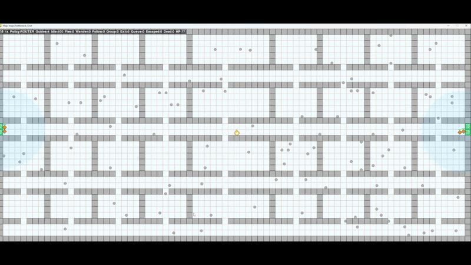

# Multi-Agent Fire Evacuation Simulation

An agent-based evacuation simulator for studying how different intelligent guide-agent strategies affect civilian survival in dynamic fire and smoke environments.

The project compares three guide policies — **Beacon**, **Sweeper**, and **Router** — against a no-guide baseline across a **14,400-run controlled factorial experiment** spanning eight building topologies, five fire locations, three crowd sizes, and 30 paired trials per condition.

Developed as part of **COMP3004 Designing Intelligent Agents** at the **University of Nottingham**.



*Router policy on a bottleneck map: civilians are coloured by state while fire and smoke spread; guide agents (orange diamonds) locate groups and escort them towards safe exits.*

---

## Key findings

Across the complete 14,400-run experiment, increasingly adaptive guide policies produced substantially higher civilian survival rates.

| Policy | Strategy | Mean survival rate |
|---|---|---:|
| None | No guide agents | **38.8%** |
| Beacon | Passive local broadcasting | **63.3%** |
| Sweeper | Reactive patrol and escort | **78.4%** |
| **Router** | **Hybrid reactive-deliberative coordination** | **82.8%** |

Main findings:

- **Router achieved the highest mean survival rate: 82.8%.**
- Router was the **best-performing policy on all eight evaluated maps**.
- Sweeper also performed strongly at **78.4%**, substantially outperforming Beacon.
- The Router advantage over Sweeper was statistically significant, although the overall pairwise effect was small (**Cohen's d ≈ 0.26**).
- Guide policy had a **large overall effect** on survival rate (**η² ≈ 0.339**).
- Router achieved approximately **73.6% survival on bottleneck maps** and **92.1% on open-plan maps**, compared with **68.1%** and **88.8%** respectively for Sweeper.
- Environmental structure mattered substantially: all policies performed better in open-plan layouts than in constrained bottleneck environments.

The results suggest that increasingly sophisticated coordination and hazard-aware planning can improve evacuation outcomes, while also showing that much of the gain can already be achieved by a simpler reactive patrol-and-escort strategy.

---

## Agent policies

### Beacon — passive communication

Beacon agents are assigned to exits and move to fixed positions near them. They then broadcast exit information to nearby civilians.

The probability that a civilian successfully receives the message decreases with:

- distance from the guide,
- smoke around the civilian,
- smoke around the guide.

Beacon represents a relatively simple communication-based intervention with little active planning.

### Sweeper — reactive search and escort

Sweeper agents actively patrol the environment, visually locate civilians, form groups, and escort them towards safe exits.

The policy combines:

- territory-based patrol,
- visual line-of-sight recruitment,
- dynamic group formation,
- congestion-aware movement,
- a **Dijkstra → safety validation → BFS** path-planning cascade,
- reactive responses to current fire and smoke conditions.

Sweeper provides a strong reactive baseline without using explicit future hazard prediction.

### Router — hybrid reactive-deliberative planning

Router is the most sophisticated policy in the simulation.

Each Router agent:

1. scans globally for civilian clusters using **DBSCAN**,
2. coordinates with other Routers through a shared blackboard,
3. claims rescue hotspots to reduce duplicated work,
4. forecasts future fire and smoke spread,
5. evaluates exits using distance, congestion and hazard information,
6. follows density-aware Dijkstra paths,
7. collects nearby civilians into groups,
8. continuously tracks incoming traffic at exits,
9. periodically re-evaluates the destination while escorting civilians.

The shared blackboard maintains:

- hotspot claims,
- live guide positions,
- exit claims and expected incoming civilians.

This allows the guides to spread themselves across the environment and reduce unnecessary overlap and exit congestion.

---

## Simulation environment

The simulator models evacuation inside a 2D grid environment containing:

- civilians,
- guide agents,
- walls and rooms,
- multiple exits,
- spreading fire,
- spreading smoke,
- health degradation,
- stochastic civilian behaviour,
- exit queues and throughput limits.

Fire and smoke are modelled using cellular-automaton-style propagation.

Civilian behaviour includes several states such as reacting, wandering, following guides, moving towards exits, queueing, escaping, and dying.

One simulation tick corresponds approximately to one second of simulated time.

---

## Experimental design

The main experiment uses a full factorial design:

```text
8 maps
× 5 fire positions
× 4 policies
× 3 crowd sizes
× 30 trials
= 14,400 simulation runs
```

### Maps

Eight `36 × 80` environments are included.

**Bottleneck layouts**

- `bottleneck_A`
- `bottleneck_B`
- `bottleneck_C`
- `bottleneck_D`

**Open-plan layouts**

- `open_plan_A`
- `open_plan_B`
- `open_plan_C`
- `open_plan_D`

The maps cover structures including narrow doorways, corridors, asymmetric exit placement, open warehouses, cubicle-like partitions and funnelled exit layouts.

### Fire positions

Each topology is evaluated with fire originating from:

- centre,
- top-left,
- top-right,
- bottom-left,
- bottom-right.

### Crowd sizes

Three crowd sizes are tested:

- 50 civilians,
- 100 civilians,
- 150 civilians.

Four guide agents are used for the three active-guide policies.

### Policies

Four experimental conditions are compared:

- `none`
- `beacon`
- `sweeper`
- `router`

---

## Statistical analysis

The analysis pipeline evaluates both overall policy performance and interactions with environmental conditions.

It produces:

- descriptive statistics with 95% confidence intervals,
- one-way ANOVA,
- two-way ANOVA for:
  - policy × map type,
  - policy × crowd size,
  - policy × fire position,
- partial η² effect sizes,
- Tukey HSD pairwise comparisons,
- Cohen's d effect sizes,
- per-map comparisons,
- cumulative evacuation statistics,
- policy summary tables.

The primary outcome is **civilian survival rate**:

```text
survival_rate = escaped / (escaped + dead)
```

For the complete experiment, policy had a large effect on survival:

```text
F ≈ 2457.6
p < 0.001
η² ≈ 0.339
```

The complete generated results are stored under `results/`.

---

## Requirements

- Python **3.10+**
- Packages listed in `requirements.txt`

Install dependencies with:

```bash
pip install -r requirements.txt
```

---

## Quick smoke test

A small four-run experiment can be used to verify the complete simulation pipeline:

```bash
python -m experiments.runner --smoke
```

This runs one simulation for each policy on `bottleneck_A` with a crowd of 100 civilians.

Approximate runtime on a modern 8-core machine:

```text
~45 seconds
```

---

## Visual demo

Launch an interactive Pygame simulation with:

```bash
python test_map_visual.py
```

The visualisation displays:

- civilians and their current states,
- guide agents,
- walls and exits,
- active fire,
- smoke propagation.

The visual configuration can be changed through the `VISUAL_*` constants in `config.py`.

For example:

```python
VISUAL_GUIDE_POLICY = "router"
VISUAL_CIVILIAN_NUMBER = 100
```

Available guide settings are:

```text
none
beacon
sweeper
router
```

---

## Running the experiment

### Smoke test

```bash
python -m experiments.runner --smoke
```

4 runs.

### Pilot experiment

```bash
python -m experiments.runner --pilot
```

960 runs.

### Full experiment

```bash
python -m experiments.runner
```

14,400 runs.

### Single policy

```bash
python -m experiments.runner --policy router
```

3,600 runs.

### Single map

```bash
python -m experiments.runner --map maps/bottleneck_A.txt
```

1,800 runs.

The default worker count is 8 and can be overridden with:

```bash
python -m experiments.runner --workers N
```

Results are streamed to:

```text
results/experiment_results.csv
```

Each completed simulation is written immediately, so previously completed runs remain available if a long experiment is interrupted.

---

## Performance

Approximate wall-clock times on an 8-core machine:

| Mode | Runs | Approx. runtime |
|---|---:|---:|
| Smoke | 4 | ~45 sec |
| Pilot | 960 | ~30 min |
| Full | 14,400 | ~7–8 hours |

Runtime varies with policy complexity and crowd size. Router with 150 civilians is the most computationally expensive configuration.

The complete experimental CSV is approximately 2 MB.

---

## Reproducibility

The experiment uses deterministic seeds derived from the trial index using `zlib.crc32`.

The same trial index is reused across experimental conditions, creating a paired/randomised-block design:

```text
trial N
├── same stochastic civilian cohort
├── same underlying random seed
├── evaluated on each policy
└── evaluated across map, crowd and fire conditions
```

This reduces noise when comparing policies because corresponding trials are matched on the same stochastic seed.

The experiment results included in this repository contain all 14,400 runs.

---

## Reproducing the analysis

Once `results/experiment_results.csv` exists, run:

```bash
python -m experiments.analysis
```

Analysis outputs are written to:

```text
results/analysis/
```

This includes statistical summaries, ANOVA outputs, Tukey comparisons, effect sizes and per-condition results.

Custom paths can also be supplied through the analysis command-line arguments.

---

## Configuration

The central simulation parameters are defined by `SimConfig` in `config.py`.

| Field | Default | Purpose |
|---|---:|---|
| `map_file` | `maps/bottleneck_A.txt` | Environment map |
| `cell_size` | `10.0` | World units per grid cell |
| `fire_position` | `center` | Fire origin |
| `n_civilians` | `50` | Number of civilians |
| `civilian_speed` | `1.5` | Civilian movement speed |
| `guide_policy` | `beacon` | Guide strategy |
| `n_guides` | `4` | Number of guides |
| `guide_speed` | `2.0` | Guide movement speed |
| `smoke_spread_rate` | `0.02` | Smoke propagation coefficient |
| `fire_spread_rate` | `0.005` | Fire propagation coefficient |
| `max_ticks` | `6000` | Simulation time limit |
| `seed` | `42` | RNG seed |
| `exit_throughput` | `2` | Civilians exiting per exit per tick |

---

## Map format

Maps under `maps/` use a simple ASCII representation:

| Character | Meaning |
|---|---|
| `.` | Walkable floor |
| `#` | Wall |
| `E` | Exit |
| `F` | Fire source |

Each experimental map contains four exits.

---

## Output data

Each row in `results/experiment_results.csv` corresponds to one simulation run.

Important columns include:

| Column | Description |
|---|---|
| `map` | Environment |
| `fire_position` | Fire origin |
| `policy` | Guide policy |
| `n_civilians` | Crowd size |
| `trial` | Trial index |
| `seed` | Deterministic RNG seed |
| `TV` | Civilians successfully evacuated |
| `TM` | Civilians killed by fire or smoke |
| `MP` | Mean remaining health of survivors |
| `MT` | Mean evacuation time |
| `survival_rate` | Primary outcome |
| `evacuation_time` | Time at which the final civilian resolves |
| `still_alive` | Unresolved civilians at the simulation limit |
| `guides_survived` | Guide survival count |

The experiment also records evacuation counts in 500-tick intervals to support evacuation-curve analysis.

---

## Project structure

```text
.
├── README.md
├── requirements.txt
├── config.py
├── test_headless.py
├── test_map_visual.py
│
├── evacsim/
│   ├── environment.py
│   ├── smoke.py
│   ├── fire.py
│   ├── civilian.py
│   ├── simulation.py
│   ├── metrics.py
│   └── guides/
│       ├── base.py
│       ├── common.py
│       ├── beacon.py
│       ├── sweeper.py
│       └── router.py
│
├── experiments/
│   ├── runner.py
│   └── analysis.py
│
├── maps/
│   ├── bottleneck_A.txt
│   ├── ...
│   └── open_plan_D.txt
│
├── results/
│   ├── experiment_results.csv
│   └── analysis/
│
└── assets/
    └── demo.gif
```

---

## Platform notes

- **Windows:** multiprocessing is protected by `if __name__ == "__main__":`.
- **Linux / macOS:** use `python3` instead of `python` where required.
- **Headless systems:** the analysis pipeline uses Matplotlib's `Agg` backend and does not require a display.
- **Linux visual mode:** Pygame may require system SDL2 development libraries.

---

## About

Developed by **Ali Karaoglu** as part of **COMP3004 — Designing Intelligent Agents** at the **University of Nottingham**, academic year **2025/26**.
